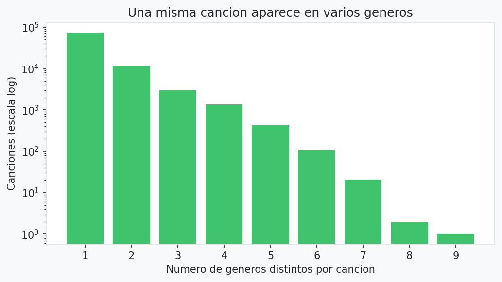

# 0. Exploración inicial

**Notebook:** `notebooks/0_exploracion_inicial.ipynb` · **Código:** `src/pipeline.py` (`cargar_datos_raw`)

## 1. Objetivo

Inspeccionar el dataset crudo (`data/raw/Spotify_Tracks_Dataset.csv`) **antes de modificarlo** para responder una pregunta: *¿qué es realmente una fila y qué podemos corregir sin perder información relevante?*

El problema de negocio es predecir si una canción será un **hit** (popularidad ≥ P80) para priorizar campañas de marketing. KPIs: AUC-ROC ≥ 0.80, gap AUC train-test < 0.05, Recall ≥ 0.75, Lift@10% ≥ 2.0.

## 2. Datos

| Aspecto | Valor |
|---|---|
| Filas / columnas | 114.000 / 21 |
| `track_id` únicos | 89.741 |
| Géneros | 114, con **exactamente 1.000 filas cada uno** |
| Variable objetivo base | `popularity` (0–100) |

## 3. Hallazgos

| Hallazgo | Dato |
|---|---|
| Nulos | 1 fila con nulo en `artists`, `album_name` y `track_name` (solo texto) |
| `Unnamed: 0` | Es solo el índice del CSV original |
| Valores imposibles | `duration_ms <= 0`: 1 fila · `tempo == 0`: 157 · `time_signature == 0`: 163 · `danceability == 0`: 157 |
| Popularidad 0 | 16.020 filas (14,05%) |
| Filas extra por `track_id` repetido | 24.259 |
| Filas completamente idénticas | 450 (solo una fracción pequeña de las repetidas) |
| Filas extra por `(artists, track_name)` repetido | 32.656 (misma canción con distinto `track_id`: otro álbum o versión) |
| Canciones en más de un género | 16.299 (18,2% de las únicas), hasta 9 géneros por canción |
| Canciones con popularidad distinta entre copias | 720 |
| P80 de popularidad | 54 sobre filas crudas · 52 sobre canciones únicas (popularidad máxima) |

**Conclusión clave:** una fila **no** es una canción. La mayor parte de las repeticiones no son duplicados exactos: son la misma canción listada en distintos géneros.



## 4. Decisiones de preprocesamiento y alternativas

| Tema | Alternativas | Decisión | Por qué |
|---|---|---|---|
| Nulos de texto | Imputar · eliminar | **Eliminar** la fila | Es 1 fila y los nulos están solo en columnas de texto; el modelo no usa el texto como tal (solo el número de artistas y marcas del título), así que imputar no aporta |
| `Unnamed: 0` | Conservar · descartar | **Descartar** | Es un índice, no información |
| Duplicados por `track_id` | (a) `drop_duplicates(keep="first")` · (b) agrupar por `track_id` | **(b)** una fila por canción, con **popularidad máxima** entre copias y **todos los géneros** | (a) se queda con un género arbitrario (depende del orden del archivo) y pierde el 18,2% de la información de género |
| Popularidad entre copias | Primera · promedio · máximo | **Máximo** | Diferencias pequeñas (720 casos); evita que el orden del archivo decida la etiqueta |
| Popularidad 0 | Eliminar · mantener | **Mantener** (cuenta como no hit) | Se concentra en ciertos géneros y artistas (ver `1_eda.md`); eliminarla borraría buena parte de esos géneros. Se verificó con una prueba de sensibilidad (ver `2_modelo.md`) |
| Valores en 0 (`tempo`, etc.) | Eliminar · mantener | **Mantener** | 0,14% de las filas; efecto despreciable |
| Versiones de una canción (`artists`+`track_name`) | Ignorar · usar de clave del split | **Clave `song_key`** para dividir | Evita que versiones de la misma canción caigan en train y test |

## 5. Lo que este paso no puede corregir

- **Muestreo de 1.000 filas por género:** el dataset se construyó con la misma cantidad por género, así que las tasas por género reflejan el muestreo y no el mercado real.
- **Popularidad es una foto en el tiempo**, sin fecha: no se puede controlar el efecto de canciones nuevas frente a antiguas.

Estas limitaciones se declaran en el informe.

## 6. Entradas y salidas

- **Entrada:** `data/raw/Spotify_Tracks_Dataset.csv`
- **Salida:** gráfico `output/graficos/00_generos_por_cancion.png`. Este notebook **no divide ni modifica** los datos.

## 7. Reproducción

```
python -m jupyter nbconvert --to notebook --execute notebooks/0_exploracion_inicial.ipynb
```
o abrir el notebook y ejecutar "Run All" desde la raíz del proyecto.
