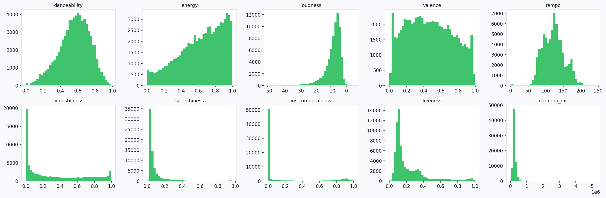
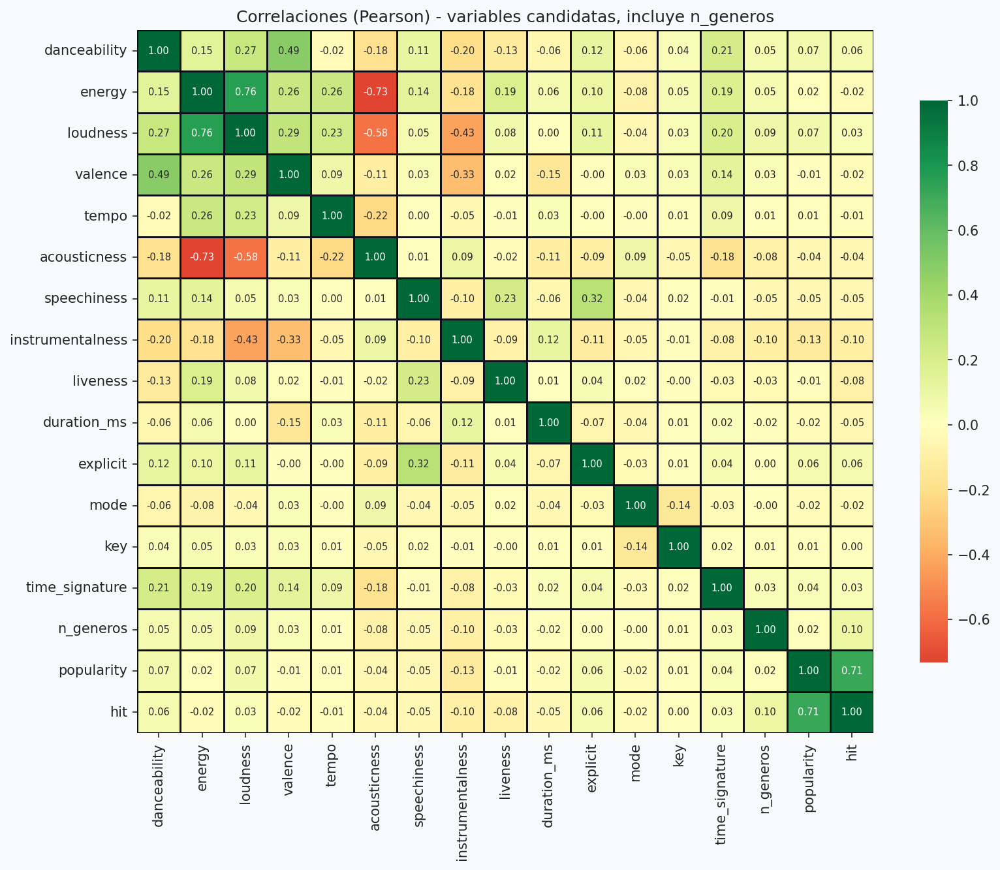
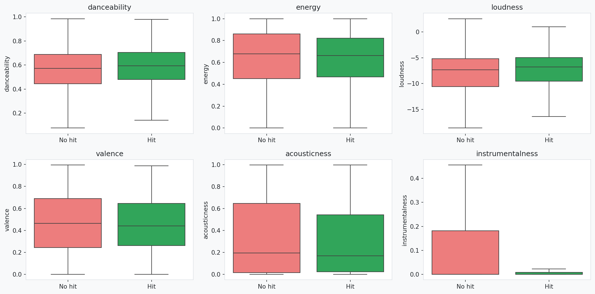
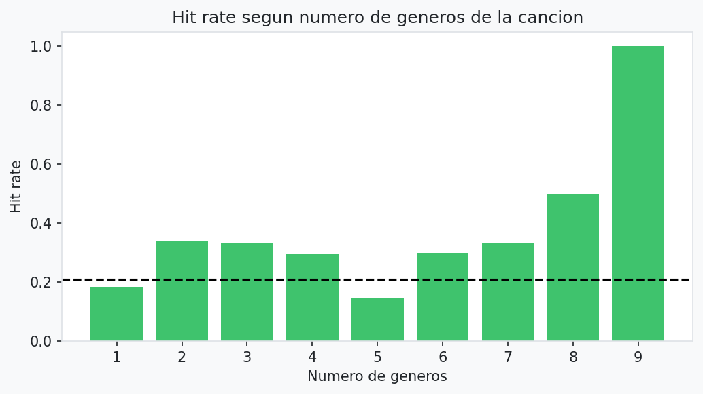
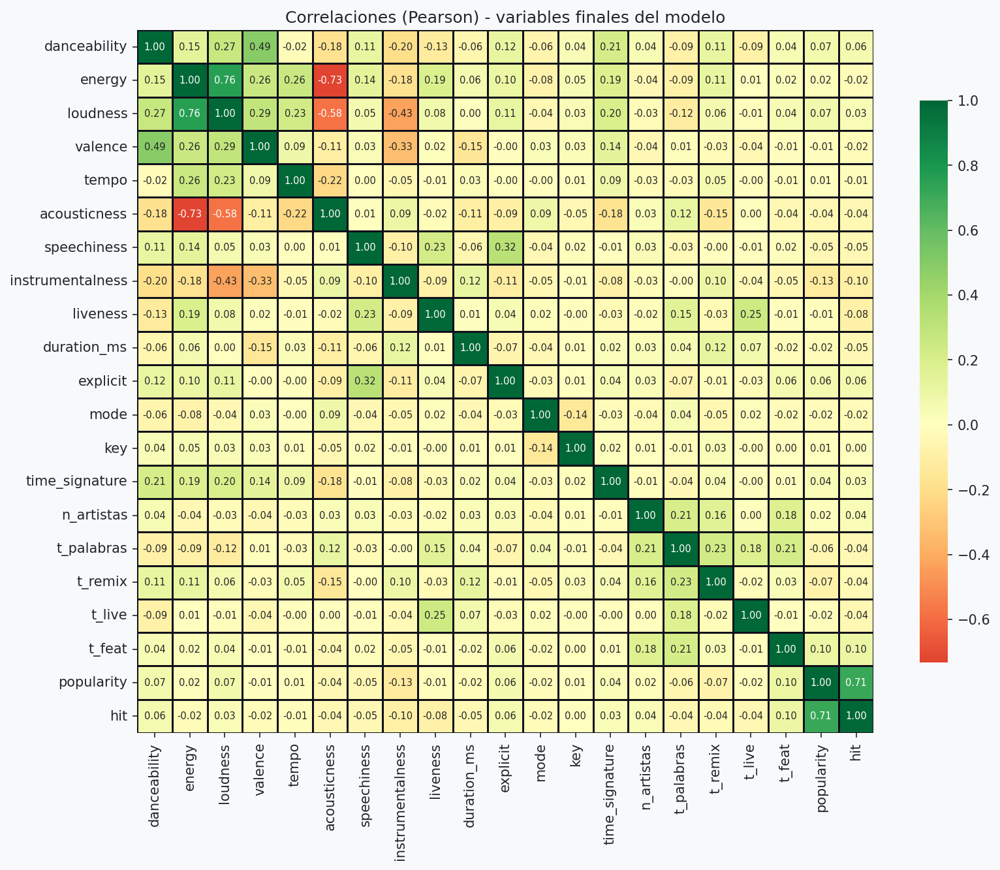

# 1. Análisis exploratorio de datos (EDA)

**Notebook:** `notebooks/1_EDA.ipynb` · **Código:** `src/pipeline.py` (`generar_split_raw`, `aplicar_transformaciones`, `generar_processed`) · **Gráficos:** `src/graficos.py`

## 1. Flujo del notebook

1. **Inicio:** `generar_split_raw()` crea (o reutiliza) `data/raw/train/raw_train.csv` y `data/raw/test/raw_test.csv`.
2. **Análisis:** todo se hace sobre **raw train**. Raw test solo sirve para comprobar que las transformaciones se aplican sin fuga y para medir el peso del género fuera de muestra.
3. **Cierre:** `generar_processed()` aplica las transformaciones y guarda `data/processed/train|test`. **No se vuelve a dividir:** son las mismas filas y el mismo orden que raw (hay un `assert` de trazabilidad por `track_id`).

Modelación (`2_Modelacion`) no divide ni transforma: solo consume `data/processed`.

## 2. Split raw y processed

| Aspecto | Valor |
|---|---|
| Canciones únicas | 89.740 |
| Raw train / test | 71.706 / 18.034 |
| Método | `GroupShuffleSplit`, grupos = `song_key` (artista + título normalizados), `random_state=42`, test = 20% |
| `song_key` compartidos train/test | 0 |
| Umbral P80 (calculado solo con train) | 52.0 |
| Hit rate train / test | 0,210 / 0,205 |
| Canciones con más de un género, train / test | 18,1% / 18,6% |
| Columnas `genre_*` (multi-hot) | 114 |

**Transformaciones en processed:** `log1p` en `speechiness`, `instrumentalness`, `liveness` y `duration_ms`; 5 variables de texto sin identidad del artista (`n_artistas`, `t_palabras`, `t_remix`, `t_live`, `t_feat`); target `hit`; multi-hot de géneros. En total, 133 variables. **El `StandardScaler` no se aplica aquí:** va dentro del `Pipeline` de `src/train.py` y se ajusta en cada fold de validación cruzada. En el EDA se muestra solo como verificación (media ≈ 0 y desvío ≈ 1 en train; en test, medias entre −0,012 y 0,020 y desvíos entre 0,992 y 1,014).

## 3. Hallazgos

### Variable objetivo
- El P80 deja ≈ 21% de hits: desbalance moderado, que se atiende con `class_weight="balanced"` y métricas que no dependen solo de accuracy.
- `popularity == 0`: 10,3% de train; es un salto en el origen, no una cola natural.
- **Decisión:** `popularity` no entra como variable (el target sale de ella: sería fuga directa); solo define el P80 y `hit`.

### Asimetría de las variables de audio

| Variable | Skew original | Skew con `log1p` |
|---|---|---|
| `duration_ms` | 10,39 | −0,32 |
| `speechiness` | 4,54 | 3,68 |
| `liveness` | 2,07 | 1,72 |
| `instrumentalness` | 1,56 | 1,48 |

`duration_ms` es la única que mejora claramente; en las otras tres la mejora es modesta y `speechiness` y `liveness` siguen asimétricas. Se mantiene `log1p` en las cuatro por consistencia: solo afecta a la Regresión Logística y al K-Means (los árboles no cambian con transformaciones monótonas). `loudness` (−1,96) no se transforma.

**Decisión:** el modelo usa las versiones `_log` de esas cuatro variables; las otras seis de audio entran en su escala original y se estandarizan dentro del `Pipeline`. `key` y `time_signature` son nominales (el tono 11 no es "mayor" que el 0) y se codifican con `OneHotEncoder`; `explicit` y `mode` ya son 0/1.

### Género (el hallazgo principal)
- Hit rate por género entre **0,00 y 0,95** (global 0,21): 4 géneros con 0 hits y 21 con más del doble del global.
- **El género por sí solo ya separa hits:** AUC usando solo el hit rate del género = **0,837 en train** y **0,831 en test** (tasas aprendidas solo con train). Es decir, supera el KPI de 0,80 sin usar audio.
- Las variables de audio tienen correlaciones individuales con el hit muy débiles (|r| ≤ 0,095): la mayor es `instrumentalness` (−0,095), seguida de `liveness` (−0,085); `explicit` (+0,065) y `danceability` (+0,059) son las positivas más altas.
- `n_generos` (0,104) tiene una correlación con el hit más alta que cualquier variable de audio o categórica de esta matriz: es la evidencia que respalda dejarla fuera de las features (ver la tabla de decisiones más abajo).
- Canciones explícitas: hit rate 0,296 frente a 0,202 en no explícitas.
- **Decisión:** el género se mantiene (114 columnas multi-hot, sin perder canciones multigénero); su peso se mide en la modelación. Ninguna variable de audio se descarta por correlación individual baja (la señal puede estar en combinaciones) y `explicit` se mantiene por su diferencia de hit rate.
- **Pearson frente a Spearman** (variables finales): todas siguen siendo débiles (|ρ| ≤ 0,097) y ningún signo cambia. Las binarias dan lo mismo con ambas medidas; con Spearman bajan `instrumentalness` (−0,095 → −0,071), `liveness` (−0,085 → −0,059) y `acousticness` (−0,041 → −0,016), y suben `loudness` (0,034 → 0,056) y `n_artistas` (0,035 → 0,052). Parte de la correlación de Pearson en las variables asimétricas viene de valores extremos; la conclusión no depende de la medida.

### Número de géneros por canción

| Géneros | Canciones (train) | Hit rate |
|---|---|---|
| 1 | 58.763 | 0,184 |
| 2 | 9.138 | 0,340 |
| 3 | 2.301 | 0,333 |
| 4 | 1.055 | 0,298 |
| 5 o más | 449 | irregular (grupos muy pequeños) |

Las canciones multigénero tienen más hits. `n_generos` no entra como variable, pero el multi-hot lo contiene de forma implícita (suma de las columnas `genre_*`); si el modelo depende de ese conteo se revisa en la modelación (`2_modelo.md`).

**Decisión:** `n_generos` no entra como variable (r = 0,104 con el hit, la más alta de la matriz candidata; posible consecuencia del éxito).

### Correlaciones entre las variables finales del modelo

La matriz anterior incluye `n_generos` para justificar por qué se descarta. Esta segunda matriz usa, en cambio, exactamente las variables que entran al modelo oficial (audio, categóricas y las 5 de texto), sin `n_generos` y sin las 114 columnas `genre_*` (no caben en un mapa de calor). Sirve para revisar colinealidad entre lo que el modelo realmente usa. La más alta está entre variables de audio: `energy` con `loudness` (0,76), `energy` con `acousticness` (−0,73) y `loudness` con `acousticness` (−0,58). Entre las de texto es baja (la mayor, `t_palabras` con `t_remix`, 0,23). Se conservan las tres de audio: HGB y Random Forest toleran la colinealidad, y en la Regresión Logística solo afecta la lectura de cada coeficiente por separado, que no se interpreta. De las variables finales, la de mayor correlación con el hit es `t_feat` (0,097).

**Decisión:** las 5 variables de texto se mantienen: no usan el nombre del artista ni el target y no son redundantes con el audio (la relación más alta es `t_live` con `liveness`, 0,25).

### Popularidad 0
- Se concentra en géneros: jazz 0,68 · iranian 0,67 · romance 0,62 · soul 0,59 · country 0,58 · latin 0,56 · rock 0,51 (7 géneros sobre 50%).
- También se concentra en artistas: de 4.957 artistas con 5 o más canciones, 121 (2,4%) tienen **todas** sus canciones en 0 y 533 (10,8%) la mitad o más, frente a un 10,3% global; por azar sería del orden de 0,2%–1,7% (mitad o más) y prácticamente imposible (todas).
- Interpretación: puede reflejar canciones **sin dato de popularidad** más que canciones realmente impopulares.

### Versiones y artistas
- Combinaciones artista+título con más de un `track_id` (train): 3.783; en 1.422 la popularidad difiere más de 10 puntos; en **1.061 aparecen versiones en ambas clases** (hit y no hit) → ambigüedad en la etiqueta.
- Los artistas tienden a ser hit o no hit en bloque: con 5 o más canciones, el 63,4% (cadena completa de artistas) y el 55,2% (artista individual) tienen todas sus canciones en la misma clase, frente a 15,1% y 14,7% si se barajaran las etiquetas.
- **Solapamiento train/test:** el 72,1% de las canciones de test tiene la misma cadena de artistas en train y el 91,7% tiene al menos un artista en común (el split agrupa por canción, no por artista).
- **Decisión:** `artists`, `album_name` y `track_name` no entran como texto ni se usa una tasa histórica por artista (el modelo memorizaría artistas). Solo se usan para `song_key` y para las 5 variables de texto. `track_id` tampoco entra (identificador; se guarda en `id_*.csv`) y `Unnamed: 0` se descartó en la exploración inicial. Matriz final: 133 variables.

## 4. Sesgos identificados y cómo se abordan

El EDA identifica los sesgos y define cómo medirlos; los resultados de esas mediciones están en `2_modelo.md`.

| Sesgo | Estado en el EDA | Qué se hizo o qué se mide después |
|---|---|---|
| Duplicados y pérdida de géneros | **Evitado** | Una fila por canción con multi-hot |
| Fuga train/test | **Evitado** | Split agrupado, P80 solo con train, escalado dentro del `Pipeline`, trazabilidad raw ↔ processed |
| Artistas repetidos entre train y test | **Identificado** | 72,1% de test comparte cadena de artistas con train; se mide con un split por artista en la modelación |
| Popularidad 0 | **Identificado, se mantiene** | Concentrada en géneros y artistas; se mide con una prueba sin popularidad 0 en la modelación |
| Dominio del género | **Identificado** | El género solo ya da AUC 0,831 en test; en la modelación se mide con ablación, importancia por permutación y recall por género |
| Conteo implícito de géneros | **Identificado** | `n_generos` se excluye; como el multi-hot lo lleva implícito, en la modelación se revisa si el modelo depende de ese conteo |
| Muestreo 1.000 filas por género | **No corregible** | Se declara como limitación |

## 5. Decisiones y alternativas

| Tema | Alternativas | Decisión | Por qué |
|---|---|---|---|
| Dónde se crea el split | Dentro de Modelación · en el EDA | **En el EDA** (`generar_split_raw`) | Las notas piden guardar splits raw y processed para trazar el impacto del preprocesamiento; Modelación solo consume datos |
| Split processed | Dividir de nuevo · mismas filas que raw | **Mismas filas, mismo orden** | Mantiene trazabilidad; hay `assert` por `track_id` |
| Método de split | Aleatorio por fila · agrupado por canción · agrupado por artista | **Agrupado por `song_key`** | Aleatorio por fila dejaría copias y versiones de una canción a ambos lados (descartado por diseño, no se midió). Agrupar por artista se prueba como sensibilidad en la modelación (ver `2_modelo.md`) |
| Umbral P80 | Sobre todo el dataset · solo train | **Solo train** (52.0) | Evita que test influya en la definición del target |
| Escalado | En `processed` · dentro del `Pipeline` | **Dentro del `Pipeline`** | Se ajusta en cada fold de la validación cruzada; en `processed` filtraría información entre folds |
| Codificación de género | Una etiqueta (`OneHotEncoder`) · multi-hot · multi-hot normalizado | **Multi-hot binario** | Conserva el 18,2% de canciones multigénero; la variante normalizada se evaluó en una corrida previa y se descartó; no tiene celda en el notebook actual (ver `2_modelo.md`) |
| `n_generos` como feature | Incluir · excluir | **Excluir** | Probable indicador indirecto de popularidad (canciones populares aparecen en más listas): hit rate salta de 0,18 (1 género) a ≈0,33 (2+) y es la variable con mayor correlación con el hit de toda la matriz candidata (0,104, gráfico `05`). Hipótesis no probada en el EDA. El multi-hot lo lleva implícito; si el modelo depende de ese conteo se revisa en la modelación (ver `2_modelo.md`) |
| Variables del texto | Ninguna · nombre o tasa histórica del artista · variables simples sin identidad | **Variables simples** (`n_artistas`, `t_palabras`, `t_remix`, `t_live`, `t_feat`) | No identifican al artista ni usan el target; su aporte se mide en la modelación. La tasa del artista se descarta porque el 72% de test comparte artista con train |
| Popularidad 0 | Eliminar · mantener | **Mantener** | Se concentra en géneros y artistas; eliminarla borraría parte de esos géneros |

## 6. Entradas y salidas

- **Entrada:** `data/raw/Spotify_Tracks_Dataset.csv`
- **Salidas de datos:** `data/raw/train|test` (`raw_train.csv`, `raw_test.csv`) y `data/processed/train|test` (`X_*.csv`, `y_*.csv`, `g_train.csv`, `id_*.csv`, `feature_names.csv`).
- **Gráficos** (`output/graficos/`): `01_distribucion_popularidad`, `02_distribuciones_numericas`, `03_hit_rate_por_genero`, `04_hit_rate_n_generos`, `05_correlaciones` (candidatas, incluye `n_generos`), `05b_correlaciones_finales` (las que usa el modelo), `06_features_por_clase`, `07_popularidad_cero`.

## 7. Limitaciones a declarar

1. Dataset con 1.000 filas por género: las tasas por género no representan el mercado.
2. Popularidad 0 concentrada en géneros y artistas; puede ser falta de dato.
3. Hay canciones con la misma etiqueta ambigua entre versiones (1.061 grupos en train).
4. El split por canción deja artistas repetidos entre train y test (el efecto se mide en `2_modelo.md`).
5. La popularidad es un momento puntual, sin fecha.

## 8. Reproducción

Ejecutar `1_EDA.ipynb` completo desde la raíz del proyecto. Si cambias la limpieza o el split, usa `generar_split_raw(forzar=True)` (o borra `data/raw/train|test`) y vuelve a ejecutar el notebook completo.
