# 2. Modelación

**Notebook:** `notebooks/2_Modelacion.ipynb` · **Código:** `src/train.py`, `src/test.py`, `src/metricas.py`, `src/graficos.py`

## 1. Qué hace este paso

Consume `data/processed/train|test` (generado al cierre del EDA; **no divide ni transforma datos**), entrena y evalúa los modelos, calibra la política de umbral del modelo oficial y complementa los resultados con análisis de sesgos. `verificar_processed()` avisa si falta `data/processed`.

## 2. Modelos y protocolo

| Modelo | Tipo |
|---|---|
| Regresión Logística | Supervisado (lineal, `lbfgs`) |
| Random Forest | Supervisado (árboles, `max_depth=15`, `min_samples_leaf=10`) |
| HistGradientBoosting | Supervisado (boosting, `max_iter=300`, `learning_rate=0.05`, profundidad libre, `max_leaf_nodes=31`, `min_samples_leaf=20`, `l2_regularization=1`) |
| K-Means | No supervisado (solo variables de audio) |

- **Variables (133):** 10 de audio (4 con `log1p`), `key` y `time_signature`, `explicit` y `mode`, 5 variables de texto sin identidad del artista (`n_artistas`, `t_palabras`, `t_remix`, `t_live`, `t_feat`) y 114 columnas `genre_*`.
- **Preprocesamiento dentro del `Pipeline`:** `StandardScaler` (numéricas, incluidas `n_artistas` y `t_palabras`), `OneHotEncoder` (`key`, `time_signature`), `passthrough` (`explicit`, `mode`, marcas de texto y las 114 columnas `genre_*`).
- **Desbalance:** `class_weight="balanced"` en los tres modelos supervisados.
- **Validación cruzada:** 5 folds estratificados y **agrupados por canción** (`song_key`), semilla 42.
- **Selección del mejor modelo:** por AUC de validación cruzada sobre train; **test se usa solo para el reporte final**.
- **Umbral de decisión (modelo oficial):** política por género y número de géneros (`src/metricas.py`), calibrada con probabilidades fuera de muestra de train (sección 5). Los tres modelos se comparan además con umbral 0,5.

## 3. Resultados

### Validación cruzada (train)

| Modelo | AUC CV | Gap CV | Recall CV | Precisión CV | F1 CV |
|---|---|---|---|---|---|
| Regresión Logística | 0,8409 | 0,0032 | 0,806 | 0,438 | 0,567 |
| Random Forest | 0,8235 | 0,0219 | 0,655 | 0,479 | 0,552 |
| **HistGradientBoosting** | **0,8678** | 0,0328 | 0,819 | 0,470 | 0,597 |

**Mejor modelo: HistGradientBoosting** (AUC de CV más alto).

### Test (18.034 canciones, hit rate 0,205)

| Modelo | AUC | PR-AUC | Precisión | Recall | F1 | Gap AUC | Lift@10% |
|---|---|---|---|---|---|---|---|
| Regresión Logística (0,5) | 0,8392 | 0,571 | 0,427 | 0,803 | 0,558 | 0,0046 | 3,04 |
| Random Forest (0,5) | 0,8273 | 0,584 | 0,456 | 0,686 | 0,548 | 0,0183 | 3,21 |
| HistGradientBoosting (0,5) | 0,8663 | 0,634 | 0,458 | 0,824 | 0,589 | 0,0299 | 3,43 |
| **HGB + umbral por género (oficial)** | **0,8663** | **0,634** | 0,423 | 0,791 | 0,551 | 0,0299 | **3,43** |

El AUC de test del mejor modelo (0,8663) es casi igual al de CV (0,8678): no hay señal de que la selección del modelo haya inflado el resultado. La política de umbral no cambia AUC, PR-AUC, gap ni lift (el ranking es el mismo); solo cambia qué canciones se marcan.

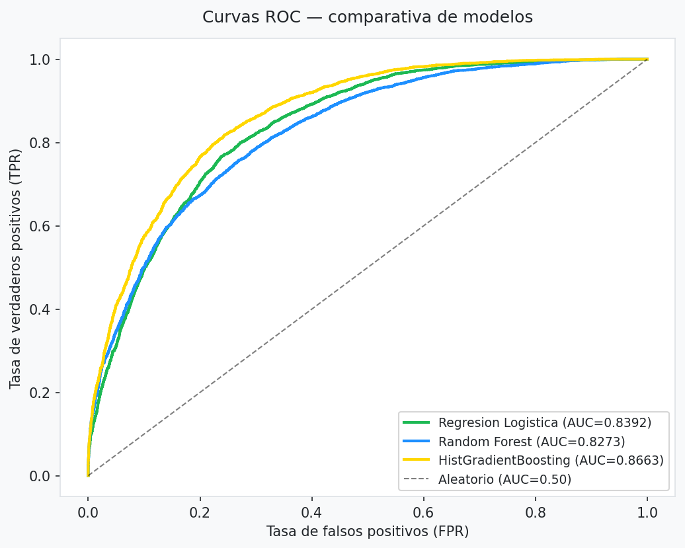

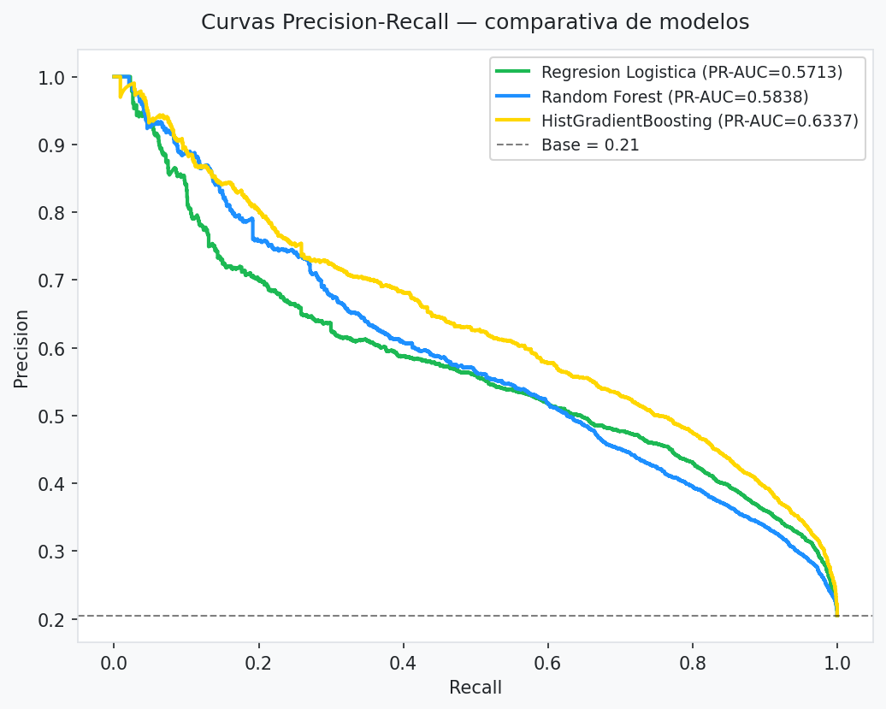

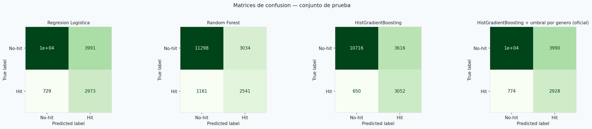

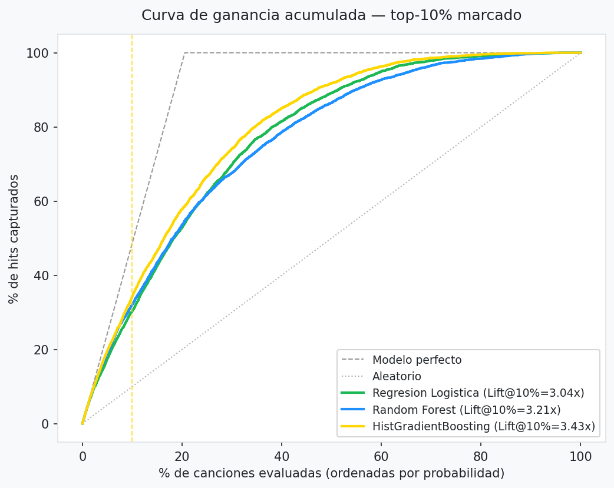

### KPIs de negocio

| KPI | Meta | HGB oficial | HGB (0,5) | Regresión Logística | Random Forest |
|---|---|---|---|---|---|
| AUC-ROC | ≥ 0,80 | 0,866 ✔ | 0,866 ✔ | 0,839 ✔ | 0,827 ✔ |
| Gap AUC | < 0,05 | 0,030 ✔ | 0,030 ✔ | 0,005 ✔ | 0,018 ✔ |
| Recall | ≥ 0,75 | 0,791 ✔ | 0,824 ✔ | 0,803 ✔ | 0,686 ✘ |
| Lift@10% | ≥ 2,0 | 3,43 ✔ | 3,43 ✔ | 3,04 ✔ | 3,21 ✔ |

> **Nota:** Random Forest no cumple el KPI de recall con umbral 0,5. Con las variables de texto marca menos (precisión 0,456, recall 0,686); en la versión anterior ya estaba al límite (0,757). No es el modelo elegido, pero debe declararse.

### Mejoras frente a la versión anterior (HGB `max_depth=6`, sin texto, umbral 0,5)

| | Versión anterior | Modelo oficial |
|---|---|---|
| AUC test / CV | 0,857 / 0,856 | **0,866 / 0,868** |
| Gap AUC | 0,026 | 0,030 |
| Lift@10% | 3,36 | **3,43** |
| Recall / Precisión | 0,833 / 0,425 | 0,791 / 0,423 |
| Recall en géneros de hit rate < 10% | 0,148 | **0,354** |
| Marcadas / hit rate, canciones de 3+ géneros | 2,27 | **1,74** |

Los tres cambios: hiperparámetros elegidos por CV (sección 11 del notebook), variables de texto (sección 13) y política de umbral (sección 10).

## 4. Lo que el modelo aprende: el género

| Prueba | Resultado |
|---|---|
| **Ablación** (HGB, CV agrupada) | AUC **0,868 con género → 0,707 sin género** (aporte +0,161) |
| **Importancia por permutación** (test) | Bloque de género: caída de AUC **0,309**; siguiente variable (`energy`): 0,009 |
| **Sin género** (test, columnas de género anuladas) | AUC 0,712 · recall 0,679 · precisión 0,321 · lift 2,13 |
| **K-Means** (solo audio, k=2 y k=7 estable) | Los clusters separan estilos sonoros pero no el éxito: con k=7 los hit rates van de 0,10 a 0,24 y usar solo el cluster da un AUC de apenas 0,576 |

**Lectura:** el KPI de AUC se cumple **gracias al género**. Sin género no se alcanza el 0,80.

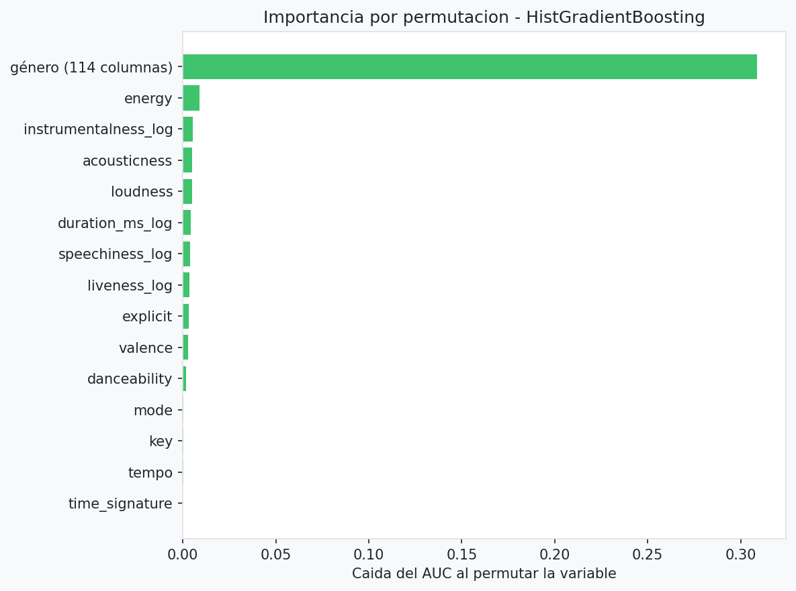

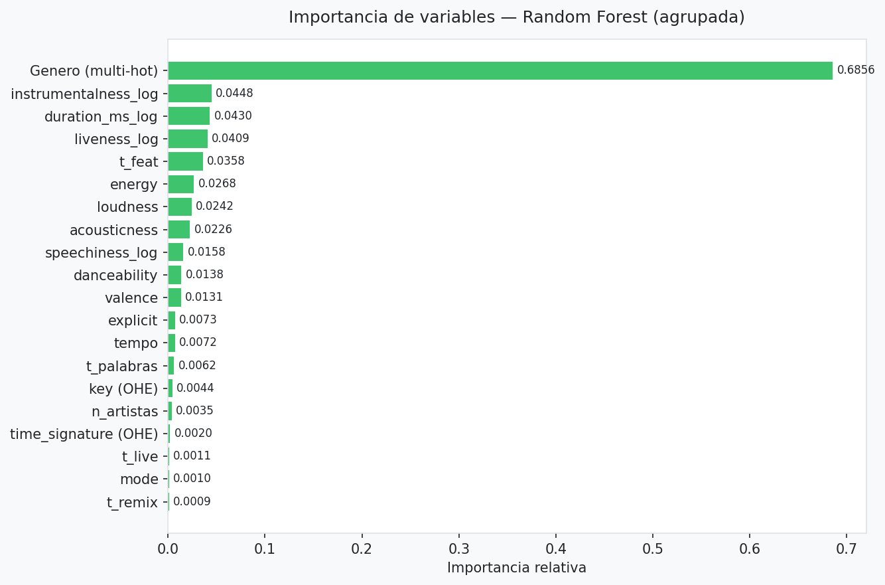

### K-Means (no supervisado, solo variables de audio)

- **Elección de k:** el silhouette más alto es k = 2 (0,240), pero solo separa "tranquilo/acústico" de "enérgico" (hit rate 0,19 frente a 0,21). Desde k = 3 los valores son bajos y parecidos (0,14 a 0,17); se revisaron también el codo y Davies-Bouldin.
- **Estabilidad:** ajustando en dos mitades de train, el acuerdo (ARI) es ≥ 0,957 hasta k = 7 y cae a 0,677 en k = 8. Se segmenta con **k = 7**.
- **Patrones:** familias de estilo (pop urbano bailable, metal y dubstep, techno instrumental, ambient/clásica, música brasileña en vivo, comedia y habla explícita, cantautor acústico) con hit rate entre ≈ 0,10 y ≈ 0,24. Usar solo el cluster da AUC 0,576.
- **Géneros por perfil de audio (k = 3, K-Means y Ward, ARI 0,47):** un grupo de 12 géneros acústicos/instrumentales (piano, ambient, guitar, disney) tiene hit rate medio 0,12 frente a 0,245 de los otros dos, y el modelo oficial los detecta algo peor (recall 0,74 frente a 0,79 y 0,80).
- **Uso de negocio:** segmentar el catálogo por estilo para adaptar campañas; no sustituye al género ni predice popularidad por sí solo.

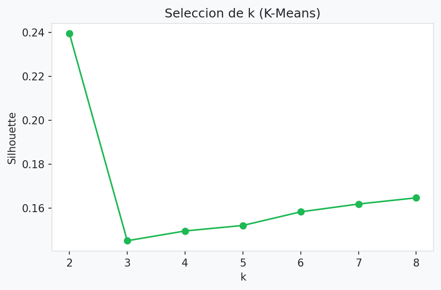

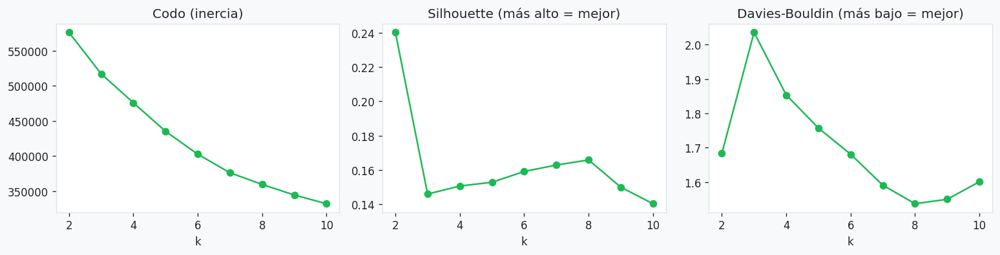

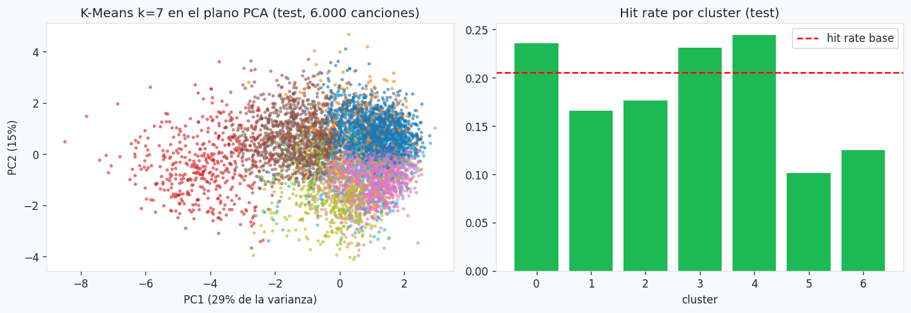

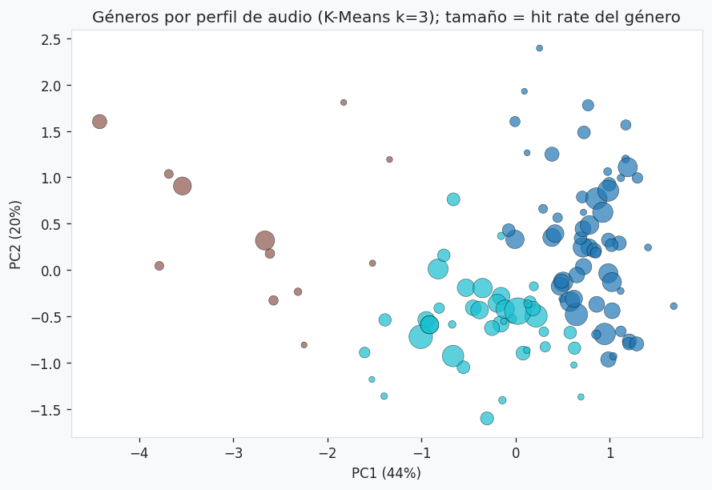

## 5. Política de umbral (HGB, calibrada en train)

### Umbrales únicos (test)

| Umbral | Precisión | Recall | F1 | % marcadas como hit |
|---|---|---|---|---|
| 0,3 | 0,354 | 0,941 | 0,514 | 54,6% |
| 0,4 | 0,397 | 0,897 | 0,551 | 46,3% |
| 0,5 | 0,458 | 0,824 | 0,589 | 37,0% |
| 0,6 | 0,524 | 0,715 | 0,605 | 28,0% |
| 0,7 | 0,603 | 0,559 | 0,581 | 19,0% |
| **Política oficial** | **0,423** | **0,791** | **0,551** | **38,4%** |

Un umbral único calibrado en train para recall 0,78 (0,537) da precisión 0,483 y recall 0,786, pero reparte el recall igual de mal entre géneros. Por eso el modelo oficial usa una política por canción.

### Cómo funciona (`src/metricas.py`)

1. **Umbral por género:** el que logra recall 0,78 sobre los hits de ese género, con probabilidades fuera de muestra de train. Si el género tiene pocos hits, se encoge hacia el umbral global: `u = a·u_género + (1 − a)·u_global`, con `a = hits / (hits + 30)`. Una canción con varios géneros usa el promedio de sus umbrales.
2. **Corrección por número de géneros (1, 2, 3+):** desplazamiento por grupo para que el recall fuera de muestra de cada grupo sea 0,78 (1: −0,019; 2: +0,034; 3+: +0,059).

Los parámetros (0,78 y 30) se fijaron antes de mirar test. No hay λ que elegir.

### Resultado (test)

| Política | Recall | Precisión | % marcadas | Recall géneros hit rate < 10% | Recall macro | % géneros con recall ≥ 0,75 | Marcadas / hit rate (1 · 2 · 3+ géneros) |
|---|---|---|---|---|---|---|---|
| Umbral 0,5 | 0,824 | 0,458 | 37,0% | 0,144 | 0,559 | 45,9% | 1,82 · 1,59 · 2,18 |
| Solo por n° de géneros | 0,787 | 0,480 | 33,7% | 0,114 | 0,502 | 40,4% | 1,72 · 1,34 · 1,74 |
| Solo por género | 0,778 | 0,433 | 36,9% | 0,350 | 0,600 | 49,5% | 1,83 · 1,62 · 1,96 |
| **Oficial (género + n° de géneros)** | **0,791** | **0,423** | **38,4%** | **0,354** | **0,591** | **48,6%** | **2,02 · 1,43 · 1,74** |
| Equidad fuerte (alternativa) | 0,833 | 0,285 | 59,9% | 0,711 | 0,771 | 71,6% | 3,42 · 1,68 · 1,86 |

- **Bootstrap (300 réplicas, diferencia pareada frente a 0,5):** recall de nicho +0,21 [0,15; 0,26], recall macro +0,03 [0,02; 0,05], recall global −0,03 [−0,05; −0,02], precisión −0,03 [−0,04; −0,03]. Las diferencias superan el ruido.
- **Equidad fuerte** (sin encogimiento, recall objetivo 0,82): casi iguala el recall entre géneros, pero 7 de cada 10 canciones marcadas no son hit. No se adopta; queda para un sello que priorice la diversidad del catálogo.

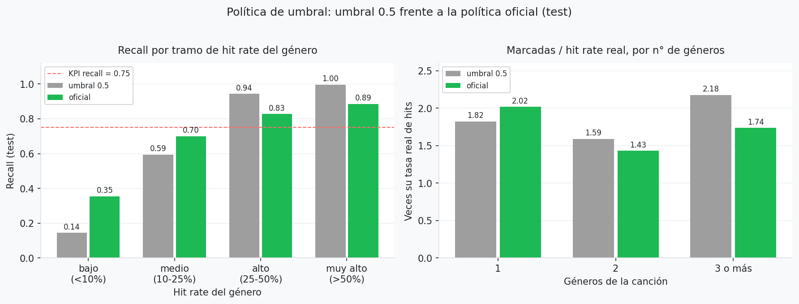

### La campaña del 10% superior

La política no cambia el ranking, así que el 10% superior sigue concentrado en géneros populares:

| Ranking | Lift@10% | % hits | Hits de géneros de nicho capturados | Géneros presentes |
|---|---|---|---|---|
| Por probabilidad (oficial) | 3,43 | 70,4% | 1,5% | 68 de 114 |
| Por margen sobre el umbral del género | 2,44 | 50,1% | 14,4% | 91 de 114 |

Ordenar por margen cumple el KPI de lift y reparte mejor la campaña, a costa de un tercio del lift. Queda como alternativa.

## 6. Recall por género (todos los géneros con al menos un hit: 109 de 114)

| Hit rate del género | Géneros | Recall (0,5) | Recall (oficial) | % marcadas (0,5) | % marcadas (oficial) |
|---|---|---|---|---|---|
| Bajo (< 10%) | 35 | 0,144 | **0,354** | 2,3% | 7,8% |
| Medio (10–25%) | 31 | 0,594 | **0,700** | 30,7% | 42,1% |
| Alto (25–50%) | 33 | 0,944 | 0,827 | 81,7% | 67,1% |
| Muy alto (> 50%) | 10 | 0,996 | 0,886 | 94,3% | 78,1% |

- Recall macro por género: 0,559 → **0,591**. Géneros bajo el KPI de 0,75: 59 → **56 (51%)**.
- Correlación entre el hit rate del género y su recall: 0,95 → **0,83**.

**Lectura:** la política traslada recall de los géneros muy populares hacia los medios y de nicho. El sesgo baja, pero no desaparece: el modelo sigue apoyándose en el género.

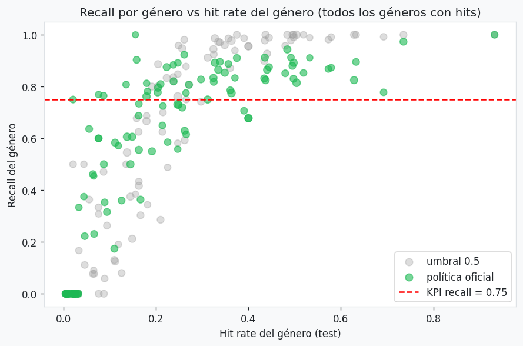

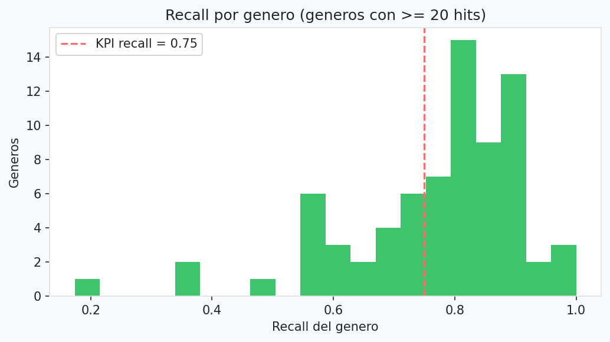

## 7. Pruebas de sensibilidad y decisión final

Cada prueba reentrena el mejor modelo (mismos hiperparámetros) cambiando solo un aspecto; se evalúan con umbral 0,5.

| # | Alternativa probada | Resultado | Decisión |
|---|---|---|---|
| 1 | **Split agrupado por artista principal** (3 semillas) en lugar de por canción | AUC 0,866 → **0,858** (−0,008), recall 0,822 → 0,796, lift 3,43 → 3,35; artistas de test vistos en train: 92% → 36% | **Se mantiene el split por canción.** El optimismo por artistas repetidos es pequeño y los KPIs se mantienen; se declara como limitación |
| 2 | **Excluir popularidad 0** (train y test; P80 pasa a 54) | AUC con género 0,866 → 0,891; sin género 0,712 → 0,730; aporte del género +0,155 → **+0,161** | **Se mantiene popularidad 0 como "no hit".** Excluirla mejora las métricas (menos ruido) pero no reduce el dominio del género |
| 3 | **Target relativo al género** (hit = popularidad ≥ P80 del género; hit rate 0,198) | AUC con género 0,665 · sin género 0,597 · lift 2,00 / 1,57. Disparidad de recall entre géneros baja (desv. estándar 0,398 → 0,170; correlación con hit rate 0,95 → 0,21) pero detecta peor (77% de géneros bajo 0,75) | **No se adopta:** cambia el problema de negocio ("¿hit dentro de su género?") y rinde mucho peor |
| 4 | **Multi-hot normalizado** (cada fila suma 1) en lugar de binario. *Evaluado en una corrida previa con el modelo anterior; no tiene celda en el notebook* | AUC +0,002; recall RF 0,757 → 0,735; canciones de 2 géneros marcadas 57% → 60% | **No se adopta:** ganancia dentro del ruido y no corrige el sobre-marcado multigénero. El sobre-marcado se corrige con la política de umbral |
| 5 | **Entrenar y evaluar solo con canciones de 1 género** | AUC 0,875 (oficial en las mismas canciones: 0,875) | El desempeño no depende del número de géneros |
| 6 | **Modelo con una fila por (canción, género)** y predicción promediada. *Prueba exploratoria fuera del notebook* | AUC 0,849; las canciones de 3+ géneros quedaron más marcadas (2,42 veces su hit rate) | **No se adopta:** empeora el AUC y no corrige el sobre-marcado |
| 7 | **Reponderar por género** (igualar hits y no hits dentro de cada género). *Prueba exploratoria fuera del notebook* | AUC 0,686 (bajo el KPI) | **No se adopta:** el modelo pierde la señal principal |
| 8 | **Ensamble HGB + Regresión Logística** | CV −0,007; test 0,858 | **No se adopta** |

### ¿El modelo premia a las canciones con más géneros?

| Géneros | Canciones (test) | Hit rate real | Esperado por sus géneros | Marcadas (0,5) | Marcadas (oficial) | Marcadas / hit rate (0,5 → oficial) | Recall (0,5 → oficial) | AUC |
|---|---|---|---|---|---|---|---|---|
| 1 | 14.678 | 0,178 | 0,195 | 32,4% | 35,9% | 1,82 → 2,02 | 0,809 → 0,793 | 0,875 |
| 2 | 2.286 | 0,346 | 0,294 | 54,9% | 49,4% | 1,59 → 1,43 | 0,844 → 0,785 | 0,824 |
| 3 o más | 1.070 | 0,279 | 0,312 | 60,8% | 48,5% | 2,18 → **1,74** | 0,906 → 0,789 | 0,795 |

**Conclusión:** con umbral 0,5 las canciones de 3 o más géneros se marcaban de más (2,18 veces su tasa de hits). La política oficial lo corrige y deja el recall parejo entre grupos (≈ 0,79). El AUC sigue siendo menor en canciones multigénero (0,813 frente a 0,875): ordenarlas es más difícil y eso el umbral no lo cambia.

### Alternativas descartadas por diseño

- Selección del modelo con test: descartado para evitar optimismo (se usa CV agrupada).
- Escalado en `processed`: descartado (filtra información entre folds).
- Tasa histórica del artista como variable: descartada (memoriza artistas; el 72% de test comparte artista con train).

### Decisión final

**Modelo: HistGradientBoosting (profundidad libre, 31 hojas, `min_samples_leaf=20`, L2 = 1), multi-hot binario, variables de texto, split agrupado por canción, target absoluto (P80 de train = 52), popularidad 0 como no hit, política de umbral por género y número de géneros.**

Se eligió porque: (a) tiene el mejor AUC de CV y de test y cumple los cuatro KPIs; (b) frente a la versión anterior sube AUC y lift, mantiene la precisión, multiplica por 2,4 el recall en géneros de nicho y corrige el sobre-marcado de canciones multigénero; (c) todo se eligió con CV o con probabilidades fuera de muestra de train, sin mirar test.

## 8. Sesgos: balance final

| Sesgo | Estado |
|---|---|
| Duplicados, fuga train/test, selección con test | **Evitados** |
| Sobre-marcado de canciones con 3 o más géneros | **Corregido** por la política de umbral (2,18 → 1,74 veces su hit rate) |
| **Recall desigual entre géneros** | **Reducido, no evitado:** nicho 0,14 → 0,35; el 51% de los géneros sigue bajo 0,75 |
| **Dominio del género** | **No evitado:** sin género el AUC cae a 0,71; la campaña del 10% superior sigue concentrada en géneros populares |
| Artistas repetidos, popularidad 0 | **Medidos, efecto pequeño** (se declaran) |
| Muestreo 1.000 filas por género | No corregible |

## 9. Limitaciones y uso recomendado

1. El KPI de AUC ≥ 0,80 depende del género; sin género el AUC es ≈ 0,71.
2. El recall sigue desigual entre géneros; la política lo reduce pero el 51% de los géneros no llega a 0,75.
3. La precisión es ≈ 0,42: más de la mitad de las canciones marcadas no son hits.
4. Dos canciones con la misma probabilidad pueden recibir decisiones distintas según su género (decisión de política, no solo técnica).
5. El split por canción deja artistas repetidos entre train y test (efecto ≈ 0,008 de AUC).
6. Popularidad 0 concentrada en géneros y artistas; puede ser falta de dato.
7. Random Forest no cumple el KPI de recall con umbral 0,5.
8. El dataset (1.000 filas por género, popularidad puntual) no permite extrapolar al mercado real.

**Uso recomendado:** priorizar canciones para campañas (lift 3,43 en el 10% superior). Si la campaña debe incluir géneros de nicho, ordenar por margen sobre el umbral del género (lift 2,44). El modelo captura sobre todo qué géneros son populares, **no** qué hace a una canción un hit; no debe usarse para afirmar que el audio de una canción causará su popularidad.

## 10. Salidas

- **Modelos:** `output/modelos/` (`regresion_logistica.joblib`, `random_forest.joblib`, `histgradientboosting.joblib`, `best_model.joblib`, `politica_umbral.joblib`) y tablas (`resultados_cv.csv`, `resultados_test.csv`, `kpis_cumplidos.csv`, `equidad_test.csv`, `ablacion_genero.csv`, `prob_oof_train.csv`, `busqueda_hiperparametros.csv`).
- **Gráficos** (`output/graficos/`): `08_curvas_roc`, `09_curvas_pr`, `10_matrices_confusion`, `13_recall_por_genero`, `14_importancia_permutacion`, `15_kmeans_silhouette`, `16_recall_vs_hit_rate_genero`, `17_kmeans_criterios_k`, `18_kmeans_pca_clusters`, `19_kmeans_generos`, `20_politica_umbral`.
- Los gráficos 01 a 12 los genera `main.py`; el 00 y del 13 al 20 los generan los notebooks.

## 11. Reproducción

```
python main.py
```
ejecuta split raw → processed → entrenamiento (con calibración de la política) → evaluación en test. Para regenerar todo desde cero, borrar `data/raw/train|test`, `data/processed` y `output/modelos` antes. El split es determinista (`random_state=42`). Las cifras de este documento son de una corrida en Linux. Las probabilidades fuera de muestra (y por lo tanto los umbrales de la política) pueden variar levemente entre sistemas operativos, así que en Windows el recall y la precisión oficiales pueden moverse en el tercer decimal.
