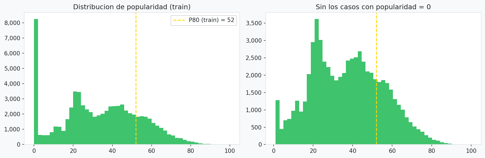
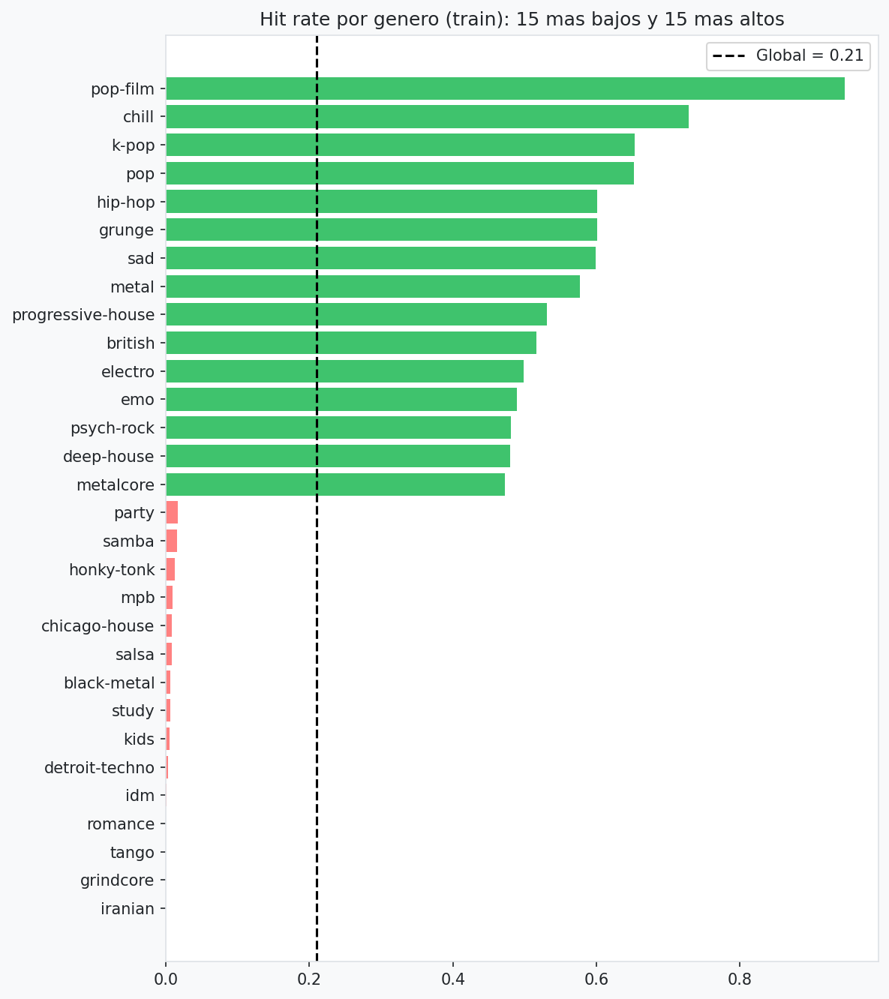
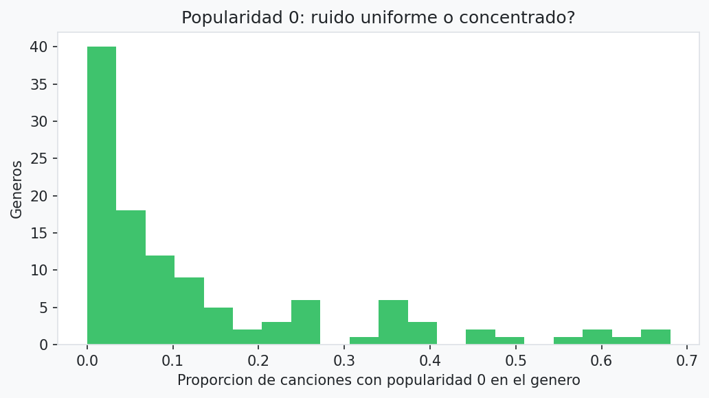

# Informe Técnico: Predicción de Popularidad en Spotify

**Asignatura:** MLY1101 Machine Learning · **Evaluación:** EP2 · **Caso C:** Spotify Tracks

## 1. Problema de Negocio
La industria musical enfrenta el constante desafío de identificar qué canciones alcanzarán el éxito comercial para optimizar la asignación de presupuestos de promoción y marketing. El presente proyecto aborda este desafío mediante un modelo de Machine Learning cuyo objetivo es **predecir si una canción en Spotify será un "hit" comercial** utilizando exclusivamente sus características intrínsecas de audio y su género musical.

La pregunta de negocio central es: *¿Debe un sello discográfico invertir presupuesto de promoción en esta canción?* Para responderla, se define un "hit" como toda canción cuya popularidad alcance o supere el **percentil 80** (P80), lo que en este estudio equivale a un umbral de 52 puntos de popularidad (calculado estrictamente sobre el conjunto de entrenamiento y aplicado a test).

## 2. Objetivos del Proyecto

**Objetivo general:** construir un modelo supervisado de clasificación binaria (hit = 1 / no hit = 0) que ordene un catálogo de canciones según su probabilidad de ser hit, para priorizar dónde invertir el presupuesto de promoción.

**Objetivos específicos:**
1. Explorar los datos crudos para detectar problemas de calidad (nulos, duplicados, popularidad 0) y sesgos antes de transformarlos.
2. Preparar los datos sin perder información ni filtrar datos de test: deduplicación agrupada por `track_id`, multi-hot de géneros, variables simples del texto y split agrupado por canción.
3. Entrenar y comparar al menos dos modelos supervisados (Regresión Logística, Random Forest y HistGradientBoosting) y elegir uno por validación cruzada, sin usar test.
4. Aplicar una técnica no supervisada (K-Means) para buscar segmentos de canciones según su perfil de audio y medir su relación con el éxito.
5. Evaluar el modelo elegido contra los cuatro KPIs de negocio, medir sus sesgos (peso del género, recall por género, sobre-marcado de canciones multigénero) y mitigarlos sin romper los KPIs, considerando su impacto ético.

## 3. KPIs de Negocio
Para asegurar que el modelo generado sea valioso para las decisiones del sello discográfico, se establecieron cuatro métricas críticas (KPIs):
1. **AUC-ROC ≥ 0.80:** capacidad del modelo para distinguir consistentemente entre un hit y un no-hit.
2. **Gap AUC train-test < 0.05:** control de sobreajuste (overfitting) para asegurar que el modelo generalice en nuevas canciones.
3. **Recall ≥ 0.75:** prioriza capturar la mayor cantidad de hits posibles (minimizando los falsos negativos, que equivaldrían a perder oportunidades).
4. **Lift @ 10% ≥ 2.0:** al enfocarse en el 10% de predicciones más altas, se espera encontrar al menos el doble de hits que si se seleccionaran canciones al azar.

## 4. Fuentes de Datos
- **Dataset:** *Spotify Tracks Dataset*, publicado en HuggingFace (`maharshipandya/spotify-tracks-dataset`), con metadatos y variables acústicas obtenidas mediante la API de Spotify. Es el mismo archivo entregado por la asignatura para el Caso C.
- **Archivo usado:** `data/raw/Spotify_Tracks_Dataset.csv`, 114.000 filas y 21 columnas (índice, `track_id`, `artists`, `album_name`, `track_name`, `popularity`, `duration_ms`, `explicit`, 11 variables de audio, `time_signature` y `track_genre`).
- **Verificación:** las 114.000 filas del archivo del repositorio son idénticas, byte a byte, a las del `Spotify_Tracks_Dataset.csv` entregado por la asignatura; solo cambia el nombre de la primera columna del encabezado (`Unnamed: 0` frente a vacío), que es el índice y no se usa en el modelo.
- **Particularidad del muestreo:** el dataset trae 1.000 filas por cada uno de sus 114 géneros, así que no refleja la proporción real de géneros en Spotify.
- Tras descartar 1 fila con nulos de texto y deduplicar (fusionando copias y consolidando géneros), se obtiene un catálogo de **89.740 canciones únicas**.

## 5. Metodología CRISP-DM
El proyecto se estructuró bajo CRISP-DM. Cada fase queda en un archivo concreto del repositorio:

| Fase CRISP-DM | Qué se hizo | Dónde está |
|---|---|---|
| 1. Comprensión del negocio | Pregunta de negocio, definición de hit (P80 de train) y cuatro KPIs | Secciones 1 a 3 de este informe, `README.md` |
| 2. Comprensión de los datos | Inspección inicial y EDA sobre datos crudos: nulos, duplicados, popularidad 0, géneros por canción, versiones y artistas | `notebooks/0_exploracion_inicial.ipynb`, `notebooks/1_EDA.ipynb`, `docs/0_exploracion_inicial.md`, `docs/1_eda.md` |
| 3. Preparación de los datos | Eliminación de nulos, deduplicación agrupada, multi-hot de géneros, variables de texto, split por `song_key`, `log1p` y escalado dentro del `Pipeline` | `src/pipeline.py`, sección 8 de `1_EDA.ipynb` |
| 4. Modelado | Regresión Logística, Random Forest, HistGradientBoosting (CV agrupada de 5 folds), búsqueda de hiperparámetros, política de umbral calibrada en train y K-Means | `src/train.py`, `src/metricas.py`, `notebooks/2_Modelacion.ipynb` |
| 5. Evaluación | Métricas en test, verificación de los 4 KPIs, ablación de género, equidad por género y por número de géneros, sensibilidades | `src/test.py`, `src/metricas.py`, `notebooks/2_Modelacion.ipynb`, `docs/2_modelo.md` |
| 6. Despliegue | Flujo reproducible de punta a punta, modelo y política serializados; uso recomendado para priorizar campañas (no se desplegó en producción) | `main.py`, `output/modelos/best_model.joblib`, `output/modelos/politica_umbral.joblib`, sección 9 de este informe |

## 6. Análisis Exploratorio (EDA) y Preparación de Datos

### 6.1. Análisis Exploratorio (EDA)
El EDA se hizo primero sobre los datos crudos, antes de transformarlos, y reveló:
- **Asimetría acústica:** variables como `duration_ms`, `speechiness`, `instrumentalness` y `liveness` presentan colas largas. Se aplicó `log1p` antes del escalado.
- **Popularidad 0:** el 10.3% del dataset registra popularidad cero. Este bloque no es una cola estadística natural, sino que se concentra en géneros específicos (jazz, iranian, romance, soul, country, latin y rock superan el 50%) y en ciertos artistas. No se elimina: se conserva con la etiqueta de "no hit".
- **Débil señal de audio:** las correlaciones lineales entre las variables acústicas y el hit son débiles; ninguna variable de audio separa por sí sola.
- **Peso del género:** usando solo el hit rate del género se obtiene un AUC de 0.837 en train y 0.831 en test.







### 6.2. Preparación de Datos
- **Nulos:** 1 fila con nulos en `artists`, `album_name` y `track_name` (solo texto). Se elimina; no se imputa porque son columnas que el modelo no usa.
- **Deduplicación agrupada:** en lugar de un `drop_duplicates` directo, se agrupa por `track_id`, se toma la popularidad máxima entre copias y se consolida la lista de todos sus géneros.
- **Codificación de género:** el 18.2% de las canciones únicas tiene más de un género, así que se aplica *multi-hot encoding* (`MultiLabelBinarizer`), con 114 columnas `genre_*`, en lugar de quedarse con un solo género.
- **Split robusto (GroupShuffleSplit):** para evitar que versiones de una misma canción queden a ambos lados, se divide agrupando por `song_key` (artista + título), con `random_state=42`. El split se hace después de deduplicar y antes de transformar, guardando tanto `data/raw/train|test` como `data/processed/train|test`. Resultado: 71.706 canciones en train y 18.034 en test.
- **Variables de texto (sin identidad del artista):** número de artistas (colaboraciones) y marcas en el título (remix, live, feat., cantidad de palabras). No usan el target. Se descarta la tasa histórica del artista porque memorizaría artistas (el 72% de test comparte artista con train).
- **Escalado:** `StandardScaler` (tras `log1p` en las asimétricas; también `n_artistas` y `t_palabras`) y `OneHotEncoder` para `key` y `time_signature`, dentro del `Pipeline` de scikit-learn, de modo que se ajustan en cada fold. La matriz final tiene 133 variables.

## 7. Modelos Supervisados: Selección y Configuración
Se evaluaron tres algoritmos de clasificación de distinta complejidad, todos con `class_weight="balanced"` (el hit es ≈ 20% de los datos):
1. **Regresión Logística** (`lbfgs`): modelo base (*baseline*) lineal, interpretable y rápido.
2. **Random Forest** (`max_depth=15`, `min_samples_leaf=10`): ensamble en paralelo de árboles; captura relaciones no lineales sin ser muy sensible a hiperparámetros u outliers.
3. **HistGradientBoosting** (`max_iter=300`, `learning_rate=0.05`, profundidad libre, `max_leaf_nodes=31`, `min_samples_leaf=20`, `l2_regularization=1`): *boosting* secuencial eficiente en datasets tabulares medianos y grandes, capaz de capturar interacciones entre audio y género.

**Protocolo de selección:** validación cruzada de 5 folds estratificada y agrupada por canción (`StratifiedGroupKFold`, semilla 42). El mejor modelo se elige por AUC de CV; el conjunto de test se usa solo para el reporte final.

**Justificación de la configuración (sección 11 del notebook):** una primera búsqueda aleatoria mostró una meseta de configuraciones con `min_samples_leaf=20`. Sobre esa meseta se recorrió una grilla de 32 configuraciones (CV agrupada de 3 folds) con una regla fijada antes de mirar test: **mayor AUC de CV con gap de CV < 0.04**. La configuración oficial empata en la cima (0.8661 frente a 0.8663, diferencia menor que la desviación entre folds). La configuración anterior (`max_depth=6`) queda 24ª de 33; en test, la oficial sube el AUC de 0.859 a 0.866 y la precisión (con umbral 0.5) de 0.430 a 0.458, con gap 0.030. Las configuraciones de 63 hojas tienen algo más de AUC, pero un gap de CV de 0.05 a 0.06, al límite del KPI; por eso la regla las excluye.

**Variables de texto (sección 13):** quitarlas baja el AUC de CV de 0.8661 a 0.8629. Mejora pequeña y consistente, sin usar la identidad del artista.

## 8. Modelación No Supervisada: K-Means
Se aplicó K-Means usando **únicamente las variables acústicas** (sin género ni popularidad), para ver si el audio por sí solo forma segmentos y si estos se relacionan con el éxito.

- **Elección de k:** el silhouette más alto es k = 2 (0.240), pero solo separa canciones "tranquilas/acústicas" de "enérgicas", con hit rate casi igual (0.19 frente a 0.21). Desde k = 3 los silhouette son bajos y parecidos (0.14 a 0.17): el audio no tiene una estructura de grupos nítida. Se usaron también el codo (inercia) y Davies-Bouldin.
- **Estabilidad:** al ajustar K-Means en dos mitades de train, el acuerdo es alto hasta k = 7 (ARI ≥ 0.957) y cae en k = 8 (0.677). Por eso se segmenta con **k = 7**.
- **Patrones encontrados:** los 7 clusters son familias de estilo (por ejemplo ambient/clásica, techno instrumental, metal y dubstep, música en vivo, comedia y habla explícita, pop urbano bailable, cantautor acústico), con hit rate entre ≈ 0.10 y ≈ 0.24 (base 0.205). Usar solo el cluster como predictor da un AUC de **0.576**.
- **Segmentos de géneros (k = 3):** agrupando los 114 géneros por su audio medio, un grupo de 12 géneros acústicos/instrumentales (piano, ambient, guitar, disney) tiene hit rate medio 0.12 frente a 0.245 de los otros dos, y el modelo oficial los detecta algo peor (recall 0.74 frente a 0.79 y 0.80). El acuerdo entre K-Means y clustering jerárquico (Ward) es moderado (ARI 0.47).
- **Aplicación al negocio:** el K-Means sirve para segmentar el catálogo por estilo y adaptar campañas a cada familia sonora; no sustituye al género ni predice popularidad por sí solo. Confirma el hallazgo del EDA: la señal de audio pura no basta para discriminar éxitos; el género es el que concentra la señal.


## 9. Interpretación de Resultados y Recomendaciones de Negocio
El modelo **HistGradientBoosting** obtuvo el mejor AUC en validación cruzada (0.868) y fue seleccionado. El **modelo oficial** es ese HGB con una **política de umbral por género y número de géneros** calibrada en train (sección 9.3). En el conjunto de prueba (18.034 canciones) cumple los cuatro KPIs.

### 9.1. Tabla Oficial de Resultados (Conjunto de Prueba)

| Modelo | Accuracy | Precision | Recall | F1-Score | AUC-ROC | Lift @10% | Gap AUC |
|---|---|---|---|---|---|---|---|
| Regresión Logística (umbral 0.5) | 0.7383 | 0.4269 | 0.8031 | 0.5575 | 0.8392 | 3.04 | 0.0046 |
| Random Forest (umbral 0.5) | 0.7674 | 0.4558 | 0.6864 | 0.5478 | 0.8273 | 3.21 | 0.0183 |
| HistGradientBoosting (umbral 0.5) | 0.7634 | 0.4577 | 0.8244 | 0.5886 | 0.8663 | 3.43 | 0.0299 |
| **HistGradientBoosting + política de umbral (oficial)** | **0.7358** | **0.4232** | **0.7909** | **0.5514** | **0.8663** | **3.43** | **0.0299** |

*HistGradientBoosting logró el mejor AUC-ROC y lift. La política de umbral no cambia el ranking (AUC, gap y lift son los mismos), solo qué canciones se marcan. Random Forest no cumple el KPI de recall con umbral 0.5 (0.686).*

**Lectura de cada KPI (modelo oficial):**
- **AUC 0.866:** si se toma al azar un hit y un no hit, el modelo le da mayor probabilidad al hit en ≈ 87% de los casos.
- **Gap 0.030:** el AUC de train (0.896) y el de test están cerca; no hay sobreajuste relevante.
- **Recall 0.791:** la política detecta el 79% de los hits de test.
- **Lift@10% 3.43:** en el 10% de canciones mejor puntuadas hay 3.43 veces más hits que en una selección al azar.

**Frente a la versión anterior** (HGB con `max_depth=6`, sin texto y umbral 0.5): el AUC sube de 0.857 a 0.866 y el lift de 3.36 a 3.43; la precisión se mantiene (0.425 → 0.423) y el recall baja de 0.833 a 0.791, todavía sobre el KPI. A cambio, el recall en géneros de nicho pasa de 0.148 a 0.354 y las canciones de 3 o más géneros dejan de marcarse de más (sección 9.3).


### 9.2. Ablación de Género y Sesgos
El peso del género musical domina las predicciones. Un análisis de ablación (entrenar el modelo con y sin las 114 variables de género, AUC de validación cruzada) lo demuestra:
- **AUC CV (Train) con género:** 0.8678
- **AUC CV (Train) sin género:** 0.7067
- **Aporte neto del género:** +0.1610 AUC

Por permutación en test, el bloque de género pesa 0.31 de AUC; la siguiente variable (`energy`), 0.009. Con umbral 0.5, el recall es 0.14 en géneros de hit rate bajo (< 10%) y ≈ 1.00 en los de hit rate muy alto (> 50%), con correlación 0.95 entre el hit rate del género y su recall.


### 9.3. Política de Umbral: Sesgo de Género y Canciones Multigénero
Con umbral 0.5 aparecen dos problemas: el recall depende casi por completo de la popularidad del género, y las canciones con 3 o más géneros se marcan 2.18 veces su tasa real de hits (las de 1 género, 1.82). La política oficial (`src/metricas.py`) los corrige sin tocar el ranking:

1. **Umbral por género:** cada género recibe el umbral que logra recall 0.78 sobre sus hits, calculado con probabilidades fuera de muestra de train. Si el género tiene pocos hits, su umbral se encoge hacia el global (`a = hits / (hits + 30)`). Una canción con varios géneros usa el promedio de sus umbrales.
2. **Corrección por número de géneros:** desplazamiento para que el recall fuera de muestra sea 0.78 en canciones de 1, 2 y 3+ géneros.

Los parámetros (0.78 y 30) se fijaron antes de mirar test. Resultado en test frente a umbral 0.5:

| | Umbral 0.5 | Política oficial |
|---|---|---|
| Recall global / precisión | 0.824 / 0.458 | 0.791 / 0.423 |
| Recall en géneros de hit rate < 10% | 0.144 | **0.354** |
| Recall macro por género | 0.559 | **0.591** |
| Géneros con recall ≥ 0.75 | 45.9% | 48.6% |
| Correlación hit rate del género vs recall | 0.95 | **0.83** |
| Marcadas / hit rate (1 · 2 · 3+ géneros) | 1.82 · 1.59 · 2.18 | 2.02 · 1.43 · **1.74** |
| Recall (1 · 2 · 3+ géneros) | 0.81 · 0.84 · 0.91 | 0.79 · 0.78 · 0.79 |

Un bootstrap de 300 réplicas confirma que las diferencias superan el ruido: recall de nicho +0.21 [0.15; 0.26] y precisión −0.03 [−0.04; −0.03].


### 9.4. Recomendaciones de Negocio
- **Usar el ranking, no solo el umbral.** Con presupuesto para el 10% superior del catálogo, ≈ 70% de las canciones promocionadas son hits y se captura ≈ 34% de todos los hits. Con la política oficial se marca el 38% del catálogo y el 58% de lo marcado no es hit.
- **Elegir el tamaño de la campaña según el presupuesto:** el 5% superior tiene ≈ 81% de hits (lift 3.93); el 20%, ≈ 59% (lift 2.89); el 40%, ≈ 44% (lift 2.13).
- **Si la campaña debe incluir géneros de nicho, ordenar por margen sobre el umbral del género.** El 10% superior por probabilidad incluye solo el 1.5% de los hits de nicho y 68 de 114 géneros; ordenado por margen, 14.4% y 91 géneros, con lift 2.44 (cumple el KPI).
- **No interpretarlo como causa:** el modelo captura sobre todo qué géneros son populares, no qué hace "buena" a una canción.

### 9.5. Alternativas Evaluadas y Decisión Final
Se adopta como oficial: HistGradientBoosting con la configuración de la sección 7, multi-hot binario, variables de texto, split por canción, target absoluto (P80 de train = 52), popularidad 0 como no hit y política de umbral por género y número de géneros. Quedan documentadas, sin adoptar:
- **Equidad fuerte** (umbral por género sin encogimiento, recall objetivo 0.82): recall de nicho 0.71 y 72% de los géneros sobre 0.75, pero precisión 0.285 y el 60% del catálogo marcado.
- **Ranking por margen** para la campaña del 10% superior (lift 2.44).
- **Modelo con una fila por (canción, género)** y predicción promediada: AUC 0.849, y las canciones de 3+ géneros quedaron más marcadas (2.42 veces su hit rate).
- **Reponderar por género:** AUC 0.686, pierde el KPI.
- **Ensamble con Regresión Logística:** empeora (test 0.858).
- **Multi-hot normalizado:** evaluado en una corrida previa con el modelo anterior; no cambiaba lo suficiente.

El sesgo de género queda **reducido y medido, no eliminado**: el modelo sigue apoyándose en el género.

## 10. Impacto Ético
- **Sesgo contra géneros de nicho:** como el modelo aprende sobre todo la popularidad del género, usarlo para repartir presupuesto concentraría la promoción en géneros ya populares. Con umbral 0.5 el recall era ≈ 0.99 en géneros muy populares y ≈ 0.14 en los de nicho. Esto puede reforzar la desigualdad de visibilidad entre géneros y artistas: las canciones que no se promocionan tienen menos oportunidad de volverse populares, y el modelo se confirmaría a sí mismo en el siguiente ciclo.
- **Mitigación adoptada:** la política de umbral sube el recall en géneros de nicho a 0.35 y corrige el sobre-marcado de canciones multigénero, manteniendo los cuatro KPIs. El costo es ≈ 3 puntos de precisión frente a umbral 0.5.
- **Lo que no se corrige:** el ranking sigue sesgado (la campaña del 10% superior casi no incluye géneros de nicho) y el 51% de los géneros sigue bajo el KPI de recall. Si el sello prioriza la diversidad, puede ordenar por margen o usar la política de equidad fuerte, asumiendo menos precisión.
- **Trato distinto según el género:** con la política, dos canciones con la misma probabilidad pueden recibir decisiones distintas según su género. Es una decisión de negocio explícita y debe comunicarse como tal.
- **Etiquetas con ruido:** la popularidad 0 se concentra en ciertos géneros y artistas y puede reflejar falta de dato más que impopularidad; tratarla como "no hit" puede perjudicar a esos grupos.
- **Uso responsable:** el modelo debe apoyar la decisión humana (priorizar qué revisar), no reemplazarla; no debe usarse para afirmar que el audio de una canción causa su éxito ni para descartar artistas.
- **Datos personales:** el dataset no contiene datos personales de usuarios; solo nombres públicos de artistas, álbumes y canciones. El modelo no usa esos nombres como variables; solo el número de artistas y marcas del título.
- **Transparencia:** las limitaciones y el sesgo de género se declaran en este informe y en `README.md`, en lugar de ocultarlos detrás del cumplimiento de los KPIs.

## 11. Limitaciones
1. **Split por canción y no por artista:** el 72.1% de las canciones de prueba comparte artista con las de entrenamiento. Al agrupar el split por artista principal, el AUC baja ≈ 0.008 (0.866 → 0.858) y los KPIs se mantienen.
2. **Ambigüedad de versiones:** hay 1.061 combinaciones artista+título que son hit en una versión y no hit en otra.
3. **Muestreo por género no natural:** el dataset trae la misma cantidad de pistas por género, lo cual no refleja el mercado real de Spotify. Las proyecciones deben ajustarse al volumen real antes de definir una estrategia de inversión.
4. **Dominancia del género:** sin género el AUC es ≈ 0.71. Invertir solo basándose en el "sonido", ignorando el género, no está respaldado por los datos.
5. **Umbral relativo:** "hit" se define como el 20% más popular del dataset, no como un criterio comercial absoluto.
6. **Cifras por género ruidosas:** los géneros de nicho tienen ≈ 7 hits cada uno en test; por eso se reportan por tramos y con bootstrap.
7. **Random Forest** no cumple el KPI de recall con umbral 0.5; no es el modelo elegido.

## 12. Reproducción
```bash
pip install -r requirements.txt   # o: conda env create -f environment.yml
python main.py                    # pipeline -> train -> test -> gráficos
```
Luego ejecutar en orden `notebooks/0_exploracion_inicial.ipynb`, `notebooks/1_EDA.ipynb` y `notebooks/2_Modelacion.ipynb` (la grilla de hiperparámetros de la sección 11 tarda ≈ 25 minutos la primera vez; luego se reutiliza `output/modelos/busqueda_hiperparametros.csv`). El split es determinista (`random_state=42`). Las cifras de este informe son de una corrida completa en Linux. Los resultados que dependen de la validación cruzada (AUC de CV, ablación, búsqueda de hiperparámetros y las probabilidades fuera de muestra con que se calibra la política de umbral) pueden variar en el tercer decimal entre sistemas operativos por diferencias numéricas en el entrenamiento; por eso, en Windows el recall y la precisión del modelo oficial pueden moverse levemente. AUC, gap y lift de test no dependen de la CV.
